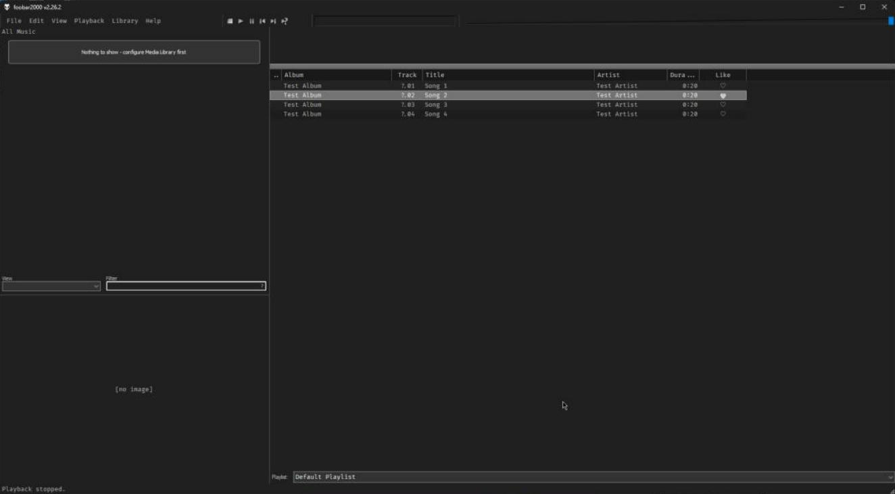

# foobar-like-music

Clickable like hearts for foobar2000. Click ♡ to like a track, click the filled heart to unlike it.

This repository has two parts, one for each kind of playlist. The component (`foo_likeheart`) adds a Like column to the standard Default UI playlist. The patch changes the playlist panel of the [NekoRoX-v2](https://gh.ali360.cloudns.ch/0xNikilite/NekoRoX-v2) theme, where the heart can also be red and liked tracks can be kept at the top.

Both store a like as a Playback Statistics rating: liking sets 5, unliking clears it. Any rating counts as liked, so stars set elsewhere also show a heart.

## Default UI component



### Requirements

- foobar2000 v2.0 or newer, 32-bit or 64-bit
- The Default User Interface playlist view
- The [Playback Statistics](https://www.foobar2000.org/components/view/foo_playcount) component (foo_playcount). Likes are stored as its ratings, so your music files are never written to.

### Install

1. Download `foo_likeheart.fb2k-component` from [Releases](../../releases).
2. In foobar2000, open File, Preferences, Components, click Install... and pick the file.
3. Click OK and let foobar2000 restart.

### Use

- Right-click the playlist's column header, open Columns and pick **Like**.
- Click a heart to like or unlike that track. Ctrl, Shift and Alt clicks keep their normal selection behavior, and a double-click toggles once and plays the track.
- Playback, **Toggle Like** likes or unlikes the selected tracks, or the playing track when nothing is selected. Bind it to a key in Preferences, Keyboard Shortcuts.
- For a page of liked songs: Library, Playlist manager, Add auto playlist, with the query `%rating% GREATER 0`.

### Limits

- The heart is one color. The Default UI playlist draws column text in a single color and only shows pictures in group headers, not on rows.
- foobar2000 has no API for clickable columns. The component watches left clicks inside foobar2000's playlist and checks whether they land in the column titled "Like". If a future foobar2000 version changes how the playlist is built, clicking may stop working. The column and Toggle Like keep working either way.
- Columns UI and script-panel playlists are not supported (for NekoRoX-v2, use the patch below).
- If clicking does nothing, open View, Console. The component logs there when Playback Statistics is missing or its rating menu can't be found.

## NekoRoX-v2 patch

[`nekorox/heart.patch`](nekorox/heart.patch) changes the theme's playlist script, `themes/NekoRoX-v2/Scripts/Panel_Playlist.js`.

### What it changes

- Every row shows ♡ next to the length. Click it to like the track and it turns into a red ♥. Click again to unlike. Clicking a heart leaves your selection alone.
- Ctrl+L likes or unlikes the selected rows.
- Right-click the track list, then Sort, then **by liked**. On a whole playlist it stays switched on (it shows a check mark): when you like or unlike a track, the playlist re-sorts with liked tracks first and keeps the existing order inside each group. Picking it again, another sort, shuffling, dragging rows or undo switches it off. With several rows selected it sorts only those, once.
- Right-click, Appearance, Rows, **Rating as heart** switches back to the original stars.

NekoRoX-v2 already ships Playback Statistics. If the panel is set to read ratings from file tags, the patch writes the RATING tag instead.

### Install

You need [Git for Windows](https://git-scm.com/download/win) for `git apply`.

1. Close foobar2000.
2. Open a terminal in the folder that contains `themes\NekoRoX-v2`, usually your foobar2000 folder. If that is under `C:\Program Files (x86)`, open the terminal as administrator.
3. Back up the original script:
   ```
   copy themes\NekoRoX-v2\Scripts\Panel_Playlist.js themes\NekoRoX-v2\Scripts\Panel_Playlist.js.bak
   ```
4. Apply the patch (use the full path to wherever you saved `heart.patch`):
   ```
   git -c core.autocrlf=false apply --ignore-whitespace C:\path\to\heart.patch
   ```
5. Start foobar2000. Right-click the track list, then Appearance, Rows, and turn on **Show rating** if it is off.

If git says the patch does not apply, your `Panel_Playlist.js` is not the stock NekoRoX-v2 file (it was edited, or it comes from another version). The patch was made against NekoRoX-v2 commit `ee49a1a`.

### Uninstall

Copy `Panel_Playlist.js.bak` back over `Panel_Playlist.js`, or run the apply command with `-R`:

```
git -c core.autocrlf=false apply --ignore-whitespace -R C:\path\to\heart.patch
```

## Tested with

- Component: foobar2000 2.26.2 64-bit and 2.25.9 32-bit, Default UI.
- Patch: foobar2000 2.25.9 32-bit, Columns UI with the NekoRoX-v2 layout, JScript Panel 2.1.8.

## Build the component

You need Visual Studio 2022 with the "Desktop development with C++" workload.

1. Download the [foobar2000 SDK](https://www.foobar2000.org/SDK) and extract it into `sdk/`, so that `sdk/foobar2000/SDK` exists. This repository was built with SDK 2026-10-01.
2. Build both platforms:
   ```
   msbuild src\foo_likeheart.vcxproj /p:Configuration=Release /p:Platform=Win32
   msbuild src\foo_likeheart.vcxproj /p:Configuration=Release /p:Platform=x64
   ```
3. The DLLs land in `build\Win32\` and `build\x64\`. For a `.fb2k-component`, zip the 32-bit `foo_likeheart.dll` at the top level and the 64-bit one as `x64\foo_likeheart.dll`, then rename the zip.

## Credits

NekoRoX-v2 by [0xNikilite](https://gh.ali360.cloudns.ch/0xNikilite/NekoRoX-v2), based on [NekoRoX](https://gh.ali360.cloudns.ch/catlinman/foobar2000) by catlinman and CaTRoX by eXtremeHunter1972. The playlist panel the patch changes is by TheQwertiest.

## License

MIT. The foobar2000 SDK is not included and has its own license. The code `heart.patch` changes belongs to the NekoRoX-v2 authors and keeps their terms.
